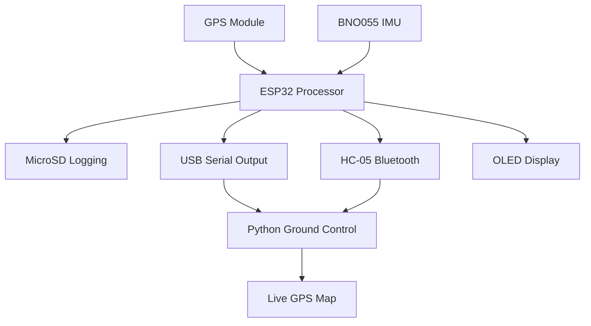

# NEXUS
### Portable GPS & IMU Localization System

**NEXUS** is an ESP32-based portable localization and telemetry platform designed to collect, process, store, and transmit real-time positioning and inertial measurement data.

The system integrates GPS positioning, inertial sensing, wireless communication, onboard data logging, and a Python-based ground-control interface into a compact, battery-powered device.

---

## Project Overview

NEXUS combines multiple embedded hardware and software components to create a portable real-time tracking and data acquisition system.

The ESP32 serves as the central processing unit, collecting GPS and IMU measurements and distributing the resulting telemetry through three simultaneous output paths:

- **MicroSD:** Continuous CSV data logging.
- **USB:** Serial telemetry streaming.
- **Bluetooth:** Wireless telemetry transmission.

A custom Python ground-control application provides live sensor monitoring, graphical visualization, and GPS mapping.

## System Features

- Real-time GPS positioning and satellite tracking.
- Three-axis accelerometer measurements.
- Three-axis gyroscope measurements.
- Three-axis magnetometer measurements.
- Continuous microSD CSV data logging.
- USB serial telemetry output.
- Wireless Bluetooth communication.
- 2.42-inch OLED status display.
- Python-based ground-control application.
- Interactive live GPS mapping.
- Real-time IMU data visualization.
- Portable battery-powered operation.
- Custom device enclosure.

## Hardware Architecture

| Component | Description |
|---|---|
| ESP32 DevKit | Main processing unit |
| u-blox LEA-6S GPS Click | GPS positioning module |
| Adafruit BNO055 | 9-axis inertial measurement unit |
| HC-05 | Bluetooth serial communication |
| MicroSD Module | Local data storage |
| SSD1309 OLED | On-device status interface |
| Battery System | Portable power supply |

### System Architecture



## Firmware

The embedded firmware is developed using the Arduino IDE and runs on the ESP32.

The ESP32 performs the following operations:

1. Initializes the GPS, IMU, OLED, microSD, and Bluetooth interfaces.
2. Continuously receives GPS positioning information.
3. Reads acceleration, angular velocity, and magnetic field measurements.
4. Formats the collected measurements into CSV records.
5. Writes sensor data to the microSD card.
6. Streams telemetry through USB and Bluetooth.
7. Updates the OLED with device and GPS status.

### Hardware Pin Configuration

| Peripheral | ESP32 GPIO | Interface |
|---|---:|---|
| GPS TX | GPIO 16 | UART RX |
| GPS RX | GPIO 17 | UART TX |
| BNO055 SDA | GPIO 21 | I2C |
| BNO055 SCL | GPIO 22 | I2C |
| OLED SDA | GPIO 21 | I2C |
| OLED SCL | GPIO 22 | I2C |
| HC-05 TXD | GPIO 26 | UART RX |
| HC-05 RXD | GPIO 27 | UART TX |
| SD CS | GPIO 25 | SPI |
| SD SCK | GPIO 18 | SPI |
| SD MOSI | GPIO 23 | SPI |
| SD MISO | GPIO 19 | SPI |

The OLED and BNO055 share the ESP32 I2C bus.

## Data Acquisition

NEXUS records GPS and IMU measurements in CSV format.

The onboard microSD logger writes data to:

`/NEXUS.CSV`

### Recorded Measurements

| Measurement | Units |
|---|---|
| Timestamp | milliseconds |
| Latitude | degrees |
| Longitude | degrees |
| Elevation | meters |
| GPS Satellites | count |
| Acceleration X, Y, Z | m/s² |
| Angular Velocity X, Y, Z | rad/s |
| Magnetic Field X, Y, Z | µT |

Each measurement is stored as a separate CSV row, allowing collected data to be analyzed using MATLAB, Python, or spreadsheet software.

## Ground-Control Application

The NEXUS ground-control application is developed in Python.

It provides a graphical interface for monitoring live telemetry received from the device.

### Features

- GPS latitude and longitude display.
- GPS satellite count and status.
- Live GPS location on an interactive map.
- Real-time acceleration measurements.
- Real-time gyroscope measurements.
- Real-time magnetometer measurements.
- Live sensor graphs.
- Start Display and End Display controls.

### Software Dependencies

Install the required Python packages:

```bash
py -m pip install pyserial matplotlib tkintermapview
```

Run the ground-control application:

```bash
py nexus_ground_control.py
```

The current application has been tested using the HC-05 Bluetooth serial connection. USB computer-side GUI collection remains to be verified.

## Getting Started

### 1. Firmware Setup

1. Install the Arduino IDE.
2. Install the ESP32 board package.
3. Install the required Arduino libraries.
4. Connect the ESP32 to your computer.
5. Select the appropriate ESP32 board and COM port.
6. Upload the NEXUS firmware.

### 2. Device Startup

1. Connect the battery power system.
2. Power on the NEXUS device.
3. Allow the GPS module to acquire satellites.
4. Verify the OLED status display.
5. Confirm microSD data logging is active.

### 3. Ground-Control Setup

1. Install Python and the required dependencies.
2. Connect to the appropriate Bluetooth serial COM port.
3. Run the ground-control application.
4. Select Start Display.
5. Monitor live GPS and IMU measurements.

## Project Development Status

| Subsystem | Status |
|---|---|
| ESP32 processing | Operational |
| GPS positioning | Tested |
| IMU measurements | Tested |
| OLED interface | Operational |
| MicroSD logging | Verified |
| USB telemetry output | Implemented |
| Bluetooth telemetry | Verified |
| Python GUI | Operational |
| Live GPS mapping | Operational |
| Battery power | Completed |
| Device enclosure | Completed |
| Fabricated PCB | In development |
| Extended runtime testing | Pending |
| USB GUI integration | Completed |

## Future Development

- Design and fabricate a custom PCB.
- Integrate all peripheral connections onto the fabricated board.
- Complete extended battery runtime testing.
- Verify simultaneous operation of all three data output paths.
- Verify USB telemetry collection through the ground-control application.
- Perform final system validation and testing.

## Technologies Used

**Embedded Systems**
- ESP32
- Arduino IDE
- C++
- UART
- I2C
- SPI

**Sensors and Communication**
- GPS
- BNO055 IMU
- HC-05 Bluetooth

**Software and Visualization**
- Python
- Tkinter
- Matplotlib
- TkinterMapView
- CSV Data Logging

## Project Purpose

NEXUS was developed as an embedded systems engineering project exploring the integration of GPS localization, inertial measurement, wireless communication, data acquisition, and real-time visualization.

The project demonstrates the development of a portable hardware platform that combines sensor interfacing, microcontroller programming, telemetry systems, and desktop software into a unified engineering solution.

---

**Project Name:** NEXUS  
**Platform:** ESP32  
**Firmware:** C++ / Arduino  
**Ground Control:** Python  
**Application:** Portable GPS & IMU Localization System
